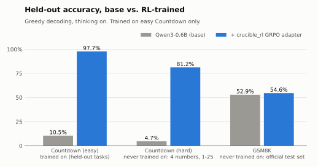
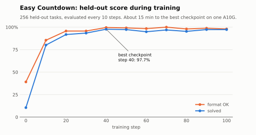
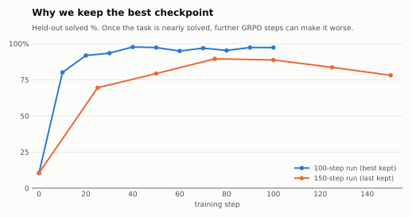
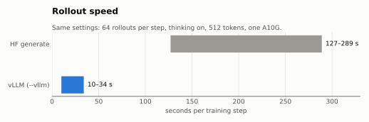

# crucible_rl

**Agentic RL for small open models, in about 300 lines you can read in one sitting.**

Put a small open LLM (0.6B–8B) in a multi-turn environment, reward it with code that checks the
answer, and train it with GRPO + LoRA on a single rented GPU. No config system, no registries, no
framework to learn: five files, each readable top to bottom.

> **Result:** RL on easy Countdown took Qwen3-0.6B from **10.5% → 97.7%** on held-out puzzles in
> about 15 minutes on one A10G. It carries over to harder puzzles it never saw (**4.7% → 81.2%**),
> and GSM8K stays where it was (52.9% → 54.6%). [Details below.](#results)

<picture>
  <source media="(prefers-color-scheme: dark)" srcset="docs/img/benchmarks-dark.svg">
  
</picture>

## Quickstart

```bash
uvx pytest -q                         # laptop, no GPU: env + rollout logic
uv tool install modal && modal setup  # one-time: cloud GPU access
modal run modal_app.py --steps 100    # trains Qwen3-0.6B + LoRA on an A10G, prints held-out evals
```

Any `main()` argument in `crucible_rl/train.py` is a flag, e.g. `--model Qwen/Qwen3-1.7B --lr 5e-5`.

## How it works

Sample 8 tasks. Let the model attempt each task 8 times (a *group*). The environment scores each
attempt; the reward is checked by code, not by a judge. An attempt's *advantage* is its reward
minus the group average, divided by the group's spread. Increase the log-probability of every
token the model wrote, weighted by that advantage. Repeat.

Tokens from prompts and environment feedback are masked out and never trained on. Trajectories
are stored token-exactly: model output is never re-tokenized, so training sees exactly what was
sampled.

```
crucible_rl/
  env.py       what an environment is     reset(task) -> prompt, step(text) -> Step
  rollout.py   play episodes              tokens + mask (1 = model wrote it, train on it)
  policy.py    the model                  many episodes, one batched GPU call
  grpo.py      the algorithm              advantage = how much better than siblings
  train.py     the loop                   rollout -> score -> update, with held-out eval
envs/
  countdown.py example environment        reach a target with + - * /, 2 turns, verified by AST
modal_app.py   run on a cloud GPU         checkpoints go to a Modal volume
```

To understand the algorithm, read `grpo.py` (25 lines), then `rollout.py` (40 lines).

## Results

### Benchmarks

The trained adapter is
[`crucible-rl/Qwen3-0.6B-Countdown-GRPO`](https://huggingface.co/crucible-rl/Qwen3-0.6B-Countdown-GRPO)
(step-40 checkpoint). Greedy decoding, thinking on; base model and adapter are evaluated with
identical prompts, budgets and graders. All numbers are in [`docs/results.json`](docs/results.json),
and `uvx --with matplotlib python docs/plots.py` regenerates every chart from it.

| Benchmark | Trained on? | Tasks | Token budget | Base | Adapter |
|---|---|---|---|---|---|
| Countdown, easy (3 numbers, 1–10) | yes (held-out tasks) | 256 | 512 | 10.5% | **97.7%** |
| Countdown, hard (4 numbers, 1–25) | no | 256 | 1024 | 4.7% | **81.2%** |
| GSM8K (official test set) | no | 1319 | 1024 | 52.9% | 54.6% |

GSM8K is within noise of the base model: general math was preserved, not improved. An earlier
GSM8K number (21.8% → 54.1%) was wrong: the grader only accepted `<answer>` tags and scored the base
model's correct `\boxed{}` answers as failures. The grader now accepts both.

### Training on easy Countdown (thinking on, vLLM rollouts)

<picture>
  <source media="(prefers-color-scheme: dark)" srcset="docs/img/training-curve-dark.svg">
  
</picture>

```bash
modal run modal_app.py --steps 100 --thinking --max-new-tokens 512 --vllm --eval-every 10
```

Held-out benchmark: 256 fixed easy Countdown tasks (3 numbers from 1–10) the model never trains on,
greedy decoding. *Solved* = the verified answer hits the target; *format OK* = the model finished
with an `<answer>` tag. Qwen3-0.6B + LoRA r=32, lr 1e-4, 8 tasks × 8 attempts per step, 512-token
thinking budget, about 10–20 s per step on one A10G.

| step | 0 | 10 | 20 | 30 | **40** | 50 | 60 | 70 | 80 | 90 | 100 |
|---|---|---|---|---|---|---|---|---|---|---|---|
| solved % | 10.5 | 80.1 | 91.8 | 93.4 | **97.7** | 97.3 | 94.9 | 96.9 | 95.3 | 97.3 | 97.3 |
| format OK % | 39.1 | 85.5 | 95.7 | 95.7 | **99.6** | 99.2 | 98.4 | 100 | 98.0 | 98.8 | 98.0 |

**What RL taught.** The base model reasons until it runs out of tokens and rarely answers (39%
format OK). After training, it tries a combination, checks it, corrects itself and answers in a
few lines, e.g. `(10*(5+1)) = 60. Too high. … (5*(10+1)) = 55. Perfect!`

**Run-to-run variance.** Sampling is not seeded. Two runs with identical settings reached 69.5% and
91.8% by step 20–25.

### Overtraining: why training keeps the best checkpoint

<picture>
  <source media="(prefers-color-scheme: dark)" srcset="docs/img/overtraining-dark.svg">
  
</picture>

In a 150-step run, the score peaked at 89.5% (step 75) and fell to 78.1% by step 150. Once almost
every attempt is correct, most groups give no signal, and the remaining updates push the model off
course. So training saves the best checkpoint (`<run>/best`) at every eval, not just the last one.

### Thinking off (first run)

Without thinking, the model must answer in one shot. 100 steps moved it from 2.7% to 33.6%
(sampled eval), almost all of it from learning the `<answer>` format; the arithmetic barely
improved. With 4 numbers from 1–25, the base model solved 0.4%: too rarely for GRPO to get any
signal. Start with a task the model sometimes solves.

### Speed

<picture>
  <source media="(prefers-color-scheme: dark)" srcset="docs/img/speed-dark.svg">
  
</picture>

| rollouts | seconds per step (thinking, 512 tokens) |
|---|---|
| HF `generate` | 127–289 |
| vLLM (`--vllm`) | 10–34 |

## Write an environment

Subclass `Env` and implement three methods:

```python
class MyEnv(Env):
    max_turns = 2

    @staticmethod
    def sample_task(rng): ...          # -> any task description
    async def reset(self, task): ...   # -> first prompt (str)
    async def step(self, action): ...  # -> Step(observation, reward, done)
```

Then `modal run modal_app.py --env mymodule:MyEnv`. See `envs/countdown.py`: about 60 lines,
multi-turn, with a reward that never executes model output.

## How this compares

| | Focus | Size |
|---|---|---|
| [TRL](https://github.com/huggingface/trl) | Many post-training algorithms, production use | Large library |
| [verl](https://github.com/volcengine/verl) | Scalable RL for LLMs on many GPUs | Large framework |
| [TinyZero](https://github.com/Jiayi-Pan/TinyZero) | Reproduce R1-Zero on Countdown | Built on verl |
| [open-r1](https://github.com/huggingface/open-r1) | Reproduce DeepSeek-R1 | Built on TRL |
| **crucible_rl** | **Multi-turn agent envs, learning by reading** | **~300 lines, no RL framework** |

crucible_rl does not compete on scale. It is meant to be the codebase you read to understand
agentic RL, and the fastest way to go from a new environment idea to a training run.

## Roadmap

- [x] **M0:** GRPO + LoRA loop, Countdown env, held-out eval, first result on Modal
- [ ] **M1:** greedy eval with format/solve scores ✓, vLLM rollouts ✓, best checkpoint ✓, capability evals, HF Hub release
- [ ] **M2:** Docker-sandboxed code-fix environment with an out-of-sandbox verifier
- [ ] **M3:** `crl` CLI, trajectory replay
- [ ] **M4:** Rust rollout scheduler and sandbox pool, remote workers

## Design rules

- Each file does one thing, and a newcomer can read it top to bottom.
- Prefer a short loop over an abstraction. Add code only when a run needs it.
- Results are shown with logs and held-out numbers, not claims.
- Rust comes in only where a benchmark shows Python is the bottleneck.

## License

MIT
