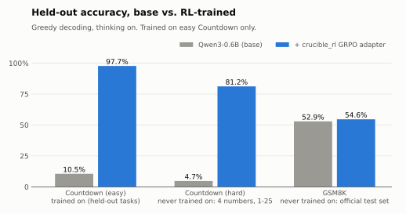
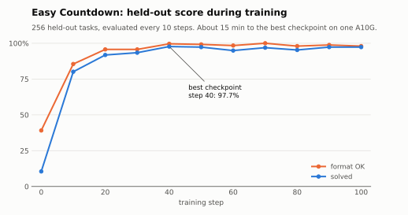
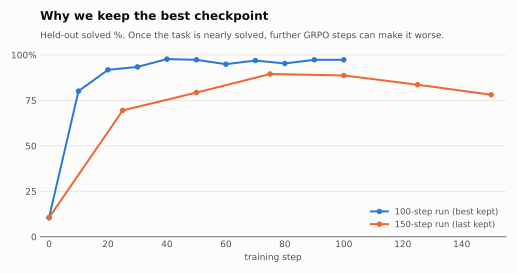
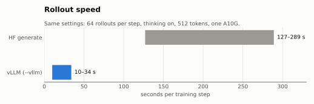

# Recipe: Countdown with Qwen3-0.6B

Teach Qwen3-0.6B to solve Countdown arithmetic puzzles with GRPO + LoRA, in about 15 minutes on one
A10G. Published adapter:
[`crucible-rl/Qwen3-0.6B-Countdown-GRPO`](https://huggingface.co/crucible-rl/Qwen3-0.6B-Countdown-GRPO).

This folder is self-contained: commands, numbers, charts and the model card for this one experiment.

| File | What |
|---|---|
| `README.md` | This page: how to reproduce, results, what we learned |
| `results.json` | Every number below. Single source for the charts and the model card |
| `img/` | Charts (light + dark, SVG + PNG), rendered by `tools/plots.py` from `results.json` |
| `model-card.md` | The Hugging Face model card, uploaded by `push` |

## Reproduce

```bash
# train: evaluates every 10 steps and keeps the best checkpoint in /ckpt/<name>/best
modal run modal_app.py --steps 100 --thinking --max-new-tokens 512 --vllm --eval-every 10 \
  --name countdown-think-vllm-100

# evaluate a checkpoint only (--steps 0); drop --init-adapter for the base model
modal run modal_app.py --steps 0 --thinking --max-new-tokens 1024 --vllm \
  --env envs.countdown:CountdownHard --init-adapter /ckpt/countdown-think-vllm-100/best --name eval-hard
modal run modal_app.py --steps 0 --thinking --max-new-tokens 1024 --vllm \
  --env envs.gsm8k:GSM8K --eval-tasks 1319 --init-adapter /ckpt/countdown-think-vllm-100/best --name eval-gsm8k

# charts and upload
uvx --with matplotlib python tools/plots.py recipes/countdown-qwen3-0.6b
modal run modal_app.py::push --name countdown-think-vllm-100/best \
  --repo crucible-rl/Qwen3-0.6B-Countdown-GRPO --recipe countdown-qwen3-0.6b
```

Training costs about $0.50 on Modal; each eval a few cents.

## Benchmarks

<picture>
  <source media="(prefers-color-scheme: dark)" srcset="img/benchmarks-dark.svg">
  
</picture>

Step-40 checkpoint. Greedy decoding, thinking on; base model and adapter are evaluated with
identical prompts, budgets and graders.

| Benchmark | Trained on? | Tasks | Token budget | Base | Adapter |
|---|---|---|---|---|---|
| Countdown, easy (3 numbers, 1–10) | yes (held-out tasks) | 256 | 512 | 10.5% | **97.7%** |
| Countdown, hard (4 numbers, 1–25) | no | 256 | 1024 | 4.7% | **81.2%** |
| GSM8K (official test set) | no | 1319 | 1024 | 52.9% | 54.6% |

GSM8K is within noise of the base model: general math was preserved, not improved. An earlier
GSM8K number (21.8% → 54.1%) was wrong: the grader only accepted `<answer>` tags and scored the base
model's correct `\boxed{}` answers as failures. The grader now accepts both.

On hard Countdown, a bigger budget helps both models (512 → 1024 tokens: adapter 70.3% → 81.2%,
base 1.2% → 4.7%), but the gap comes from training, not from the budget.

## Training

<picture>
  <source media="(prefers-color-scheme: dark)" srcset="img/training-curve-dark.svg">
  
</picture>

Held-out benchmark: 256 fixed easy Countdown tasks (3 numbers from 1–10) the model never trains on,
greedy decoding. *Solved* = the verified answer hits the target; *format OK* = the model finished
with an `<answer>` tag. Qwen3-0.6B + LoRA r=32, lr 1e-4, 8 tasks × 8 attempts per step, 512-token
thinking budget, about 10–20 s per step on one A10G.

| step | 0 | 10 | 20 | 30 | **40** | 50 | 60 | 70 | 80 | 90 | 100 |
|---|---|---|---|---|---|---|---|---|---|---|---|
| solved % | 10.5 | 80.1 | 91.8 | 93.4 | **97.7** | 97.3 | 94.9 | 96.9 | 95.3 | 97.3 | 97.3 |
| format OK % | 39.1 | 85.5 | 95.7 | 95.7 | **99.6** | 99.2 | 98.4 | 100 | 98.0 | 98.8 | 98.0 |

## What we learned

**What RL taught.** The base model reasons until it runs out of tokens and rarely answers (39%
format OK). After training, it tries a combination, checks it, corrects itself and answers in a
few lines, e.g. `(10*(5+1)) = 60. Too high. … (5*(10+1)) = 55. Perfect!`

**Overtraining: keep the best checkpoint.**

<picture>
  <source media="(prefers-color-scheme: dark)" srcset="img/overtraining-dark.svg">
  
</picture>

In a 150-step run, the score peaked at 89.5% (step 75) and fell to 78.1% by step 150. Once almost
every attempt is correct, most groups give no signal, and the remaining updates push the model off
course. So training saves the best checkpoint (`<run>/best`) at every eval.

**Run-to-run variance.** Sampling is not seeded. Two runs with identical settings reached 69.5% and
91.8% by step 20–25; both peaked above 89%.

**Start where the model sometimes succeeds.** With 4 numbers from 1–25 and no thinking, the base
model solved 0.4%: too rarely for GRPO to get any signal. On easy Countdown without thinking, 100
steps moved it from 2.7% to 33.6% (sampled eval), almost all from learning the `<answer>` format.
Thinking was what made the arithmetic improve.

**Grade fairly.** Our first GSM8K grader only accepted `<answer>` tags and made the base model look
far worse than it is. Always read sample outputs before trusting a gap.

## Speed

<picture>
  <source media="(prefers-color-scheme: dark)" srcset="img/speed-dark.svg">
  
</picture>

| rollouts | seconds per step (thinking, 512 tokens) |
|---|---|
| HF `generate` | 127–289 |
| vLLM (`--vllm`) | 10–34 |
